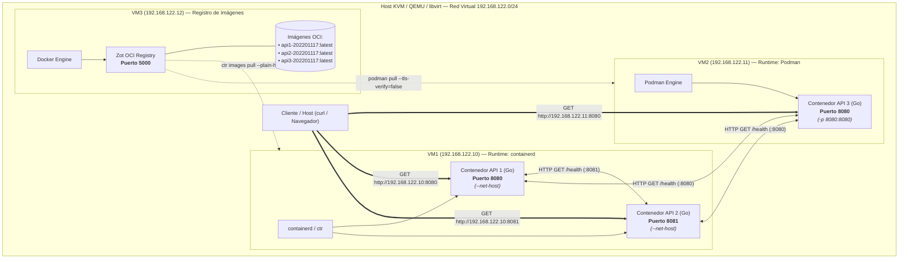
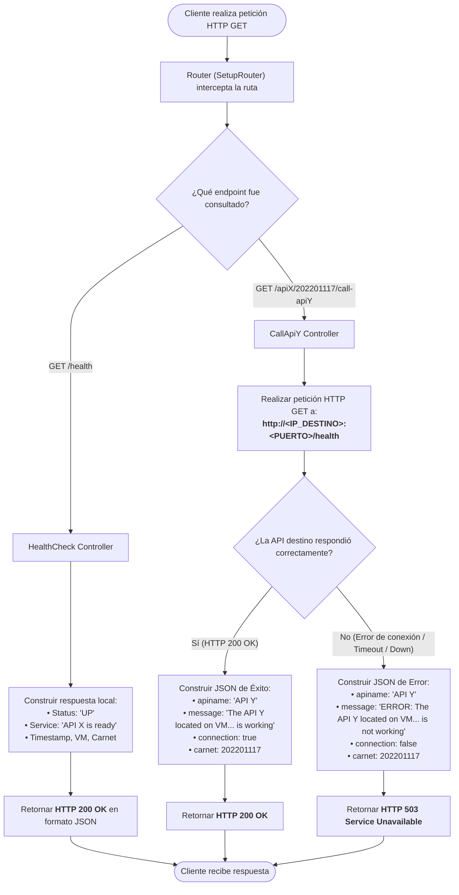

# MANUAL DE USO DE CONTENEDORES Y SERVICIOS

Guía práctica para la descarga, ejecución y prueba de los contenedores de los servicios en las máquinas virtuales, la VM1 `containerd`, VM2 en `podman`, consumiendo las imágenes almacenadas en el registro Zot hospedado en la VM3 `192.168.122.12:5000`


---

## ARQUITECTURA DE LAS MÁQUINAS VIRTUALES

A continuación se presenta la topología de red y distribución de servicios implementada sobre **VirtManager** con **QEMU/KVM** en el segmento de red virtual `192.168.122.0/24`:



---

## DIAGRAMA DE FLUJO DE COMUNICACIÓN DE LAS APIS

Las APIs desarrolladas en Go manejan dos tipos de solicitudes: **chequeo de estado propio (`/health`)** y **llamadas distribuidas inter-servicio (`/call-apiX`)**.

### 1. Lógica de Ejecución y Manejo de Respuestas




---

## SETUP DE VM1 - CONTAINERD

En la máquina virtual **VM1** se utilizan el motor de contenedores `containerd` y la herramienta de línea de comandos `ctr` para descargar y ejecutar las imágenes de la **API1** (puerto 8080) y la **API2** (puerto 8081).

### Paso 1. DESCARGAR LAS IMAGENES DESDE ZOT REGISTRY

Ejecutamos el comando `ctr` indicando el flag `--plain-http` debido a que el registro local de Zot en la VM3 no posee certificado SSL/TLS habilitado. Cada uno de estos comandos lo que hace es hacer pull de las imagenes de zot

```bash

sudo ctr images pull --plain-http 192.168.122.12:5000/api1-202201117:latest


sudo ctr images pull --plain-http 192.168.122.12:5000/api2-202201117:latest
```

### Paso 2. EJECUCION DE LOS CONTENEDORES

Una vez descargadas las imágenes, procedemos a instanciar y levantar los contenedores para API1 y API2 en segundo plano.

```bash

sudo ctr run --detach --net-host 192.168.122.12:5000/api1-202201117:latest api1

sudo ctr run --detach --net-host 192.168.122.12:5000/api2-202201117:latest api2
```

#### Descripcion de los parametros

Donde `api1` y `api2`seran los nombres asignados a los contenedores dentro del runtime de containerd.


## SETUP DE VM2 - PODMAN

En la máquina virtual **VM2** se utiliza `podman` para gestionar la descarga y ejecución de la imagen correspondiente a la **API3** en el puerto 8080.

### Paso 1. DESCARGAR LA IMAGEN DESDE ZOT REGISTRY

Descargamos la imagen de la API3 desde el registro Zot en VM3 especificando que no se verifique la firma TLS.

```bash
podman pull --tls-verify=false 192.168.122.12:5000/api3-202201117:latest
```


### Paso 2. EJECUCION DEL CONTENEDOR

Con la imagen disponible localmente, corremos el contenedor exponiendo y mapeando el puerto 8080.

```bash
podman run -d -p 8080:8080 --name api3 192.168.122.12:5000/api3-202201117:latest
```


## VERIFICACION DE LOS SERVICIOS

Para comprobar la disponibilidad y correcta comunicación entre las distintas APIs en las máquinas virtuales, se pueden realizar peticiones `curl` a los siguientes endpoints:

### Endpoints de API1 (VM1 - http://192.168.122.10:8080)
```bash
curl http://192.168.122.10:8080/health
curl http://192.168.122.10:8080/api1/202201117/call-api2
curl http://192.168.122.10:8080/api1/202201117/call-api3
```

### Endpoints de API2 (VM1 - http://192.168.122.10:8081)
```bash
curl http://192.168.122.10:8081/health
curl http://192.168.122.10:8081/api2/202201117/call-api1
curl http://192.168.122.10:8081/api2/202201117/call-api3
```

### Endpoints de API3 (VM2 - http://192.168.122.11:8080)
```bash
curl http://192.168.122.11:8080/health
curl http://192.168.122.11:8080/api3/202201117/call-api1
curl http://192.168.122.11:8080/api3/202201117/call-api2
```
