# GUIA DE INSTALACION
## INSTALACION DE QEMU - KVM - VIRTMANAGER
### 1. INSTALAR LOS PAQUETES NECESARIOS
``` bash
sudo pacman -Syu qemu-full virt-manager virt-viewer dnsmaq
```
#### Descripcion de cada paquete
- qemu-full: motor de virtualizacion 
- virt-manager: GUI para administras las VM
- virt-viewer: Visor para simular la pantalla de la VM
- dnsmaq: Sirve para DHCP y DNS ligero
### 2. HABILITAR EL SERVICIO Y AGREGAR EL USUARIO AL GRUPO
``` bash
sudo systemctl enable --now libvirtd.service

sudo usermod -aG libvirt $USER
```

### 3. CREAR LA MAQUINA VIRTUAL


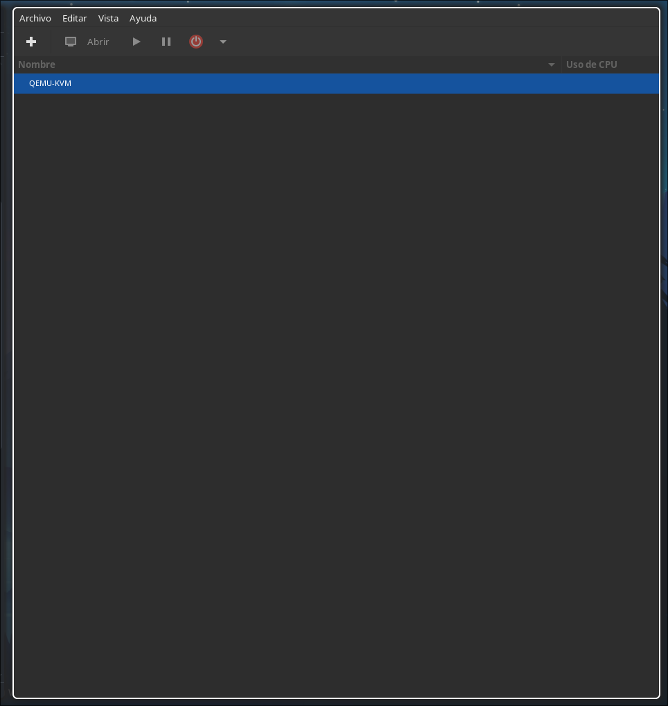

#### Paso 1. Descargar la ISO
Descargamos la ISO desde la pagina oficial del distribuidor, en este caso estaremos usando arch linux por lo cual descargaremos desde la pagina de https://archlinux.org/download/

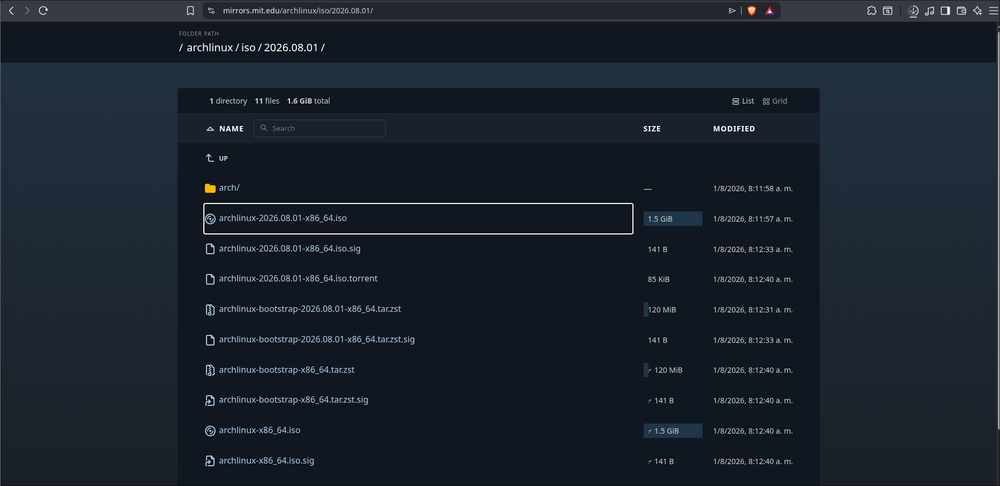
#### Paso 2. Seleccion de ISO

Una vez en virt manager le damos al boton de `+` para crear una nueva VM, una vez abierta esa opcion buscamos nuestro archivo `.iso` y lo seleccionamos

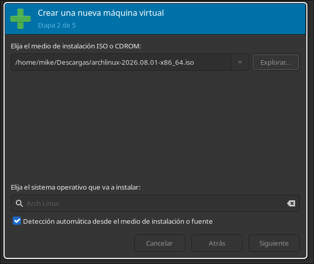

#### Paso 3. Asingacion de Memoria

Asignamos que cantidad de memoria virtual le queremos asginar a la VM, como solo sera por medio de CLI se le asginara 3GB de RAM y 3 nucleos de procesador

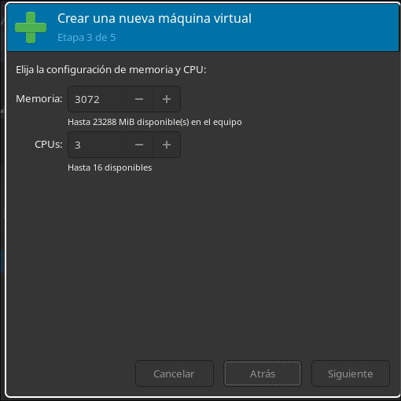

#### Paso 4. Almacenamiento

Asignamos 20GB a cada maquina para su almacenamiento permanente

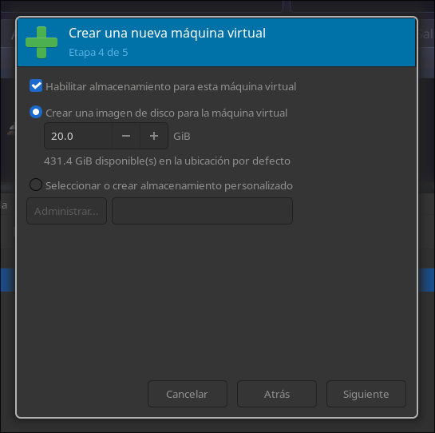

#### Paso 5. Fin de la configuracion

Verificamos que todos los parametros de la VM esten correctos y finalizamos la etapa de creacion de la VM

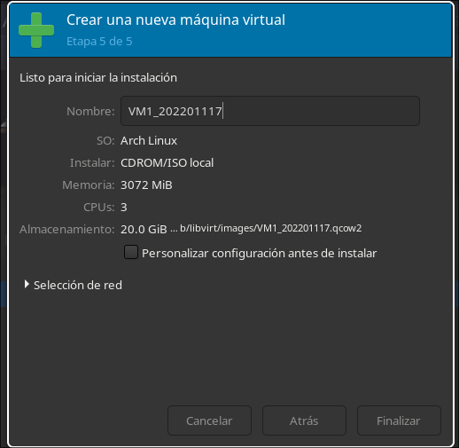

### 4. CONFIGURAR EL SISTEMA OPERATIVO

Utilizaremos archinstall como instalador para facilitiar la instalacion. 

#### Archinstall

Una vez dentro del boot de nuestra distro lo que haremos es escribir 
`archinstall` en la terminal

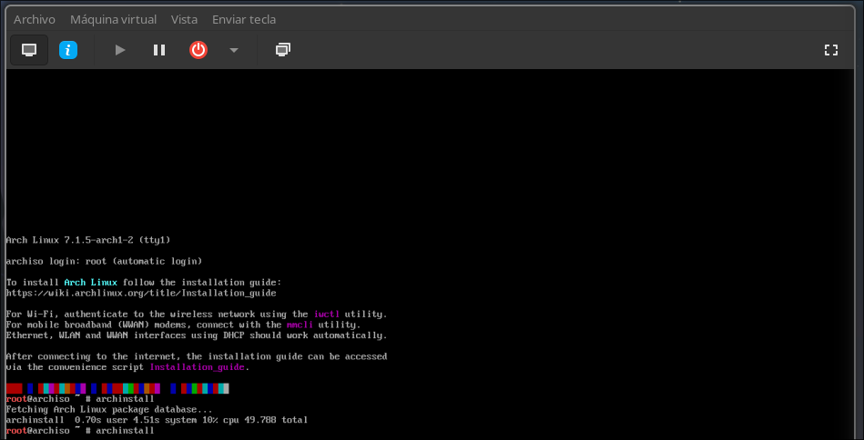

y esto nos mostrara el instalador para que realicemos la configuracion de nuestro sistema operativo
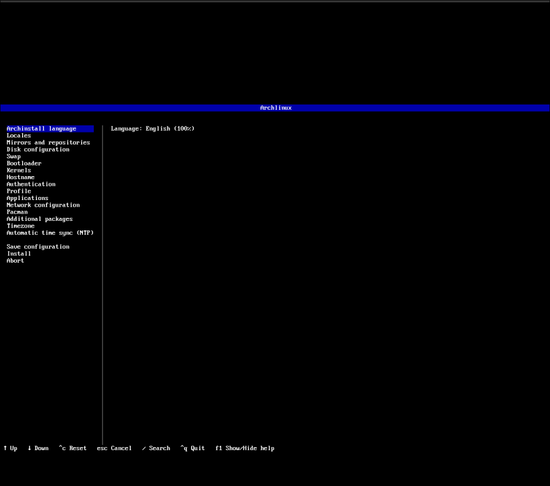

Elegimos idioma, distribucion de teclado, dejamos que el mismo instalador configure el particionamiento del disco, añadimos contraseña del root y usuario. Para luego configurar zona horaria e instalamos

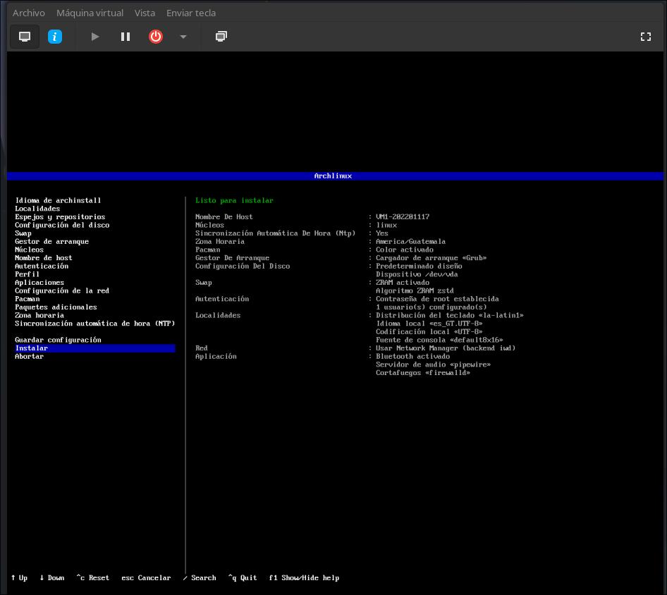

Al finalizar la instalacion seleccionamos que deseamos reiniciar e iniciamos sesion con nuestro usuario y actualizaremos el sistema usando
```bash
sudo pacman -Syu
```
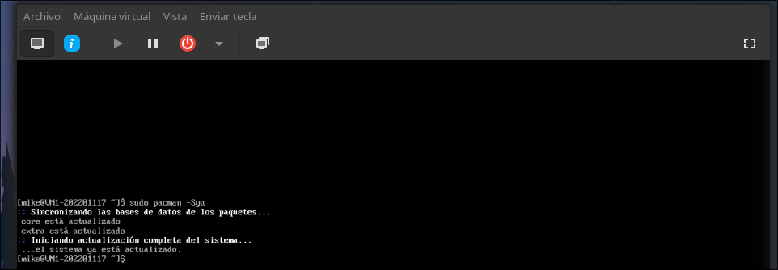

y repetimos el mismo proceso para las otras 2 maquinas virtuales

### 5. CONFIGURACION IP ESTATICA

Con el siguiente comando obtendremos todas nuestras VM y a partir de estos podremos ver la informacion de sus direcciones.
```bash
sudo virsh list --all
```
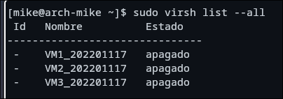

ya con esta lista de las VM ejecutamos el comando 
```bash
sudo virsh domiflist *nombre de la VM*
```
para obtener la direccion MAC su direccion mac para asignarle una ip estatica

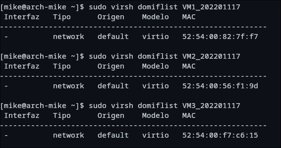

una vez con las direcciones, en la maquina host debemos editar el XML de la red, en este caso con el comando  net-edit default. Utilizamos la flag EDITOR para seleccionar que edictor de texto queremos utilizar, en el caso de este proyecto usaremos NeoVim (nvim)
```bash
sudo EDITOR=nvim virsh net-edit default
```

Una vez adentro del archivo de configuracion buscaremos la etiquieta de DHCP y agregamos una entrada host por cada VM que vamos a configurar. Asi obtenemos este resultado

```XML
<host mac='52:54:00:82:7f:f7' name='VM1_202201117' ip='192.168.122.10'/>
<host mac='52:54:00:56:f1:9d' name='VM2_202201117' ip='192.168.122.11'/>
<host mac='52:54:00:f7:c6:15' name='VM3_202201117' ip='192.168.122.12'/>
```

Una vez con esta configuracion reiniciamos la red para aplicar los cambios con:
```bash
sudo virsh net-destroy default
sudo virsh net-start default
```

Esto se hace para quemar la ip hacia donde se deben las peticiones de las apis

## SETUP DE VM3

usaremos ssh para copiar los archvos de nuestra maquina host a la VM3 donde crearemos nuestras imagenes

### Requisitos

#### Paquetes
Instalamos ssh en la VM3 usando pamcan y despues habilitanto el servicio de ssh
```bash
sudo pacman -S openssh
sudo systemctl enable --now sshd
```

Una vez realizado la instalacion y habilitacion de ssh usaremos scp para copiar el codigo desde la maquina host hasta la vm

```bash
scp -r /ruta/202201117_LAB_SO1_2S2026/ mike@192.168.122.12:/home/mike
```
### INSTALACION ZOT

Para poder correr zot de primero debemos instalar docker y git en nuestra VM y lo haremos con el siguiente comando, para luego habilitar el servicio de docker y lo agregamos al grupo de usuarios
```bash
sudo pacman -S git docker
sudo systemctl enable --now docker
usermod -aG docker $USER
```

Luego con docker creamos un contenedor con la ulitmima imagen zot diponible, en el caso de la maquina host es AMD se usara esa version, con el comando para levatar zot en el puerto 5000

```bash
docker run -d -p 5000:5000 --name zot-registry --name zot ghcr.io/project-zot/zot-linux-amd64:latest
```

Una vez con el contenedor de zot corriendo en la VM3 lo que haremos es crear la imagen de las API, asegunrandonos que estemos en la carpeta donde se encuentre el Dockerfile de la API. Este comando lo podemos ejectoras con el resto de los dockerfiles de las API cambiando entre carpetas
```bash
docker build -t apiX-202201117 .
```

Una vez ya con las imagenes creadas necesitamos tagearlas para subirlas a zot y poder referenciarlas.

```bash 
docker tag apiX-202201117 localhost:5000/apiX-202201117
```

Ya una vez taggeada la imagen debemos hacer el push referenciando el tag de las imagenes con docker push
```bash
docker push localhost:5000/apiX-202201117
```

Para revisarlas imagenes que tenemos en zot tenemos que hacer un request a `localhost:5000/v2/_catalog` para verificar que se haya subido correctamente

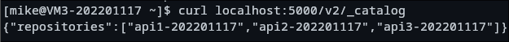