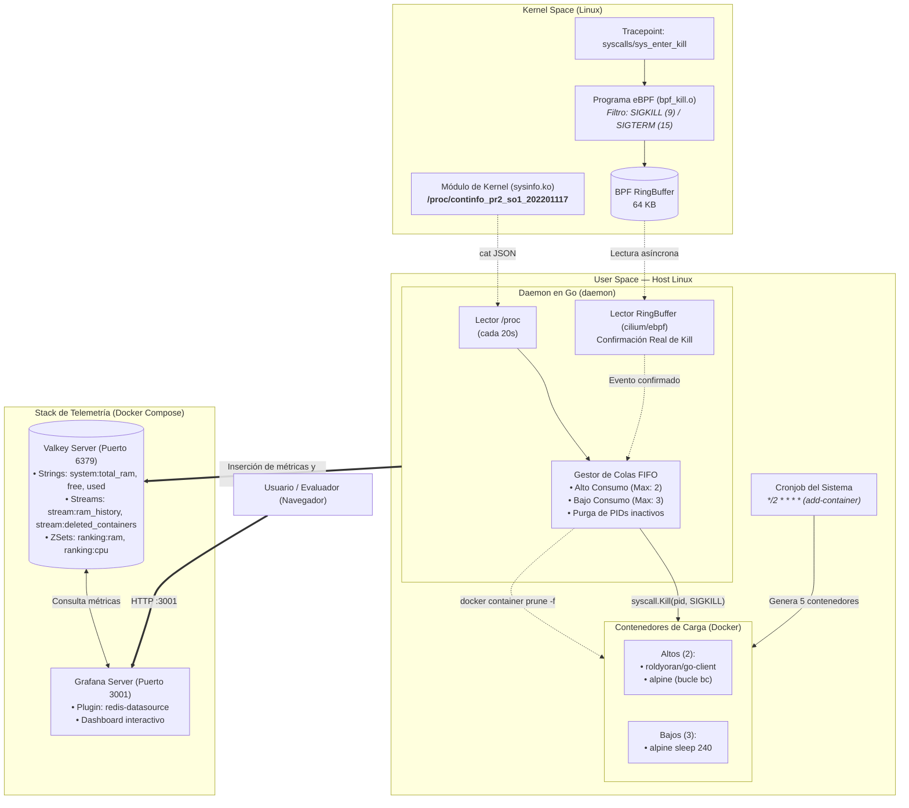
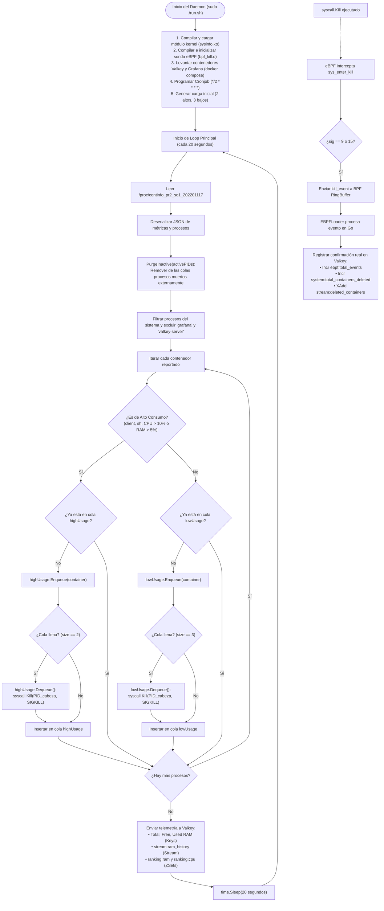
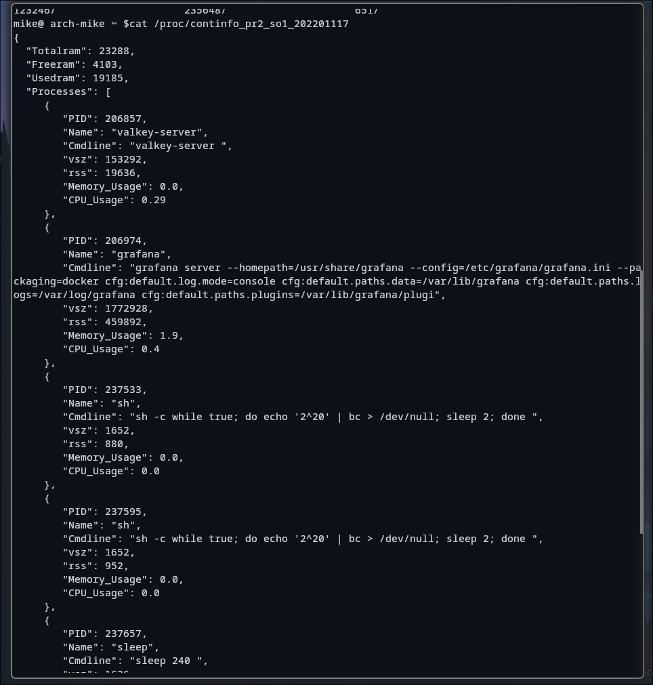
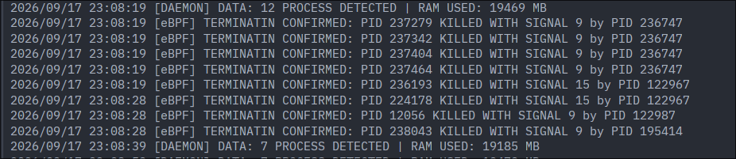
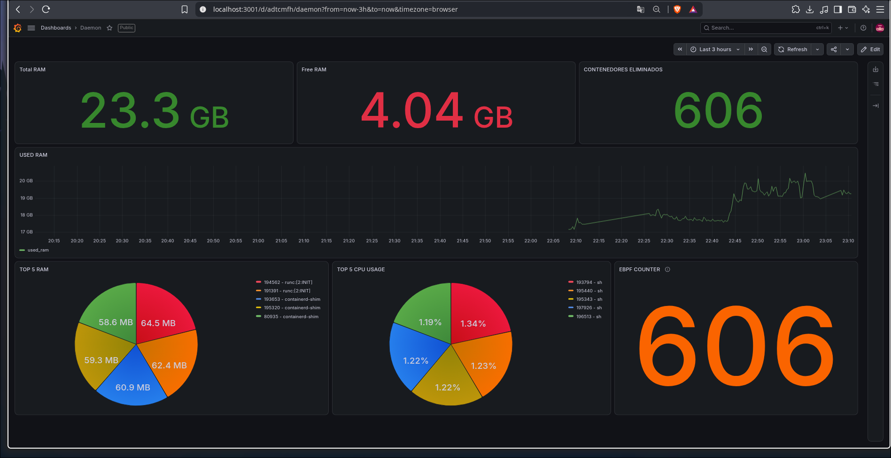

# PROYECTO 2
## Miguel Galicia - 202201117


## 1. ARQUITECTURA DEL SISTEMA

Distribución de componentes y flujo de datos entre el espacio de kernel (Kernel Space), el daemon en espacio de usuario (User Space) y los servicios de almacenamiento/visualización:



---

## 2. DIAGRAMA DE FLUJO: CICLO PRINCIPAL DEL DAEMON Y DECISIONES FIFO



---

## 3. MANUAL TÉCNICO (DETALLES DE IMPLEMENTACIÓN)

### 3.1 Módulo de Kernel en C (`sysinfo.c`)
* **Estructura base:** Itera el árbol de procesos con `for_each_process(task)`.
* **Aislamiento de contenedores:** Filtra instancias donde `task->comm` coincide con `containerd-shim` y navega hacia `task->children` para obtener el proceso hijo real (contenedor).
* **Métricas de memoria:** Extrae datos mediante `si_meminfo(&si)` (`totalram`, `freeram`) y del `mm_struct` (`total_vm` para VSZ, `get_mm_rss` para RSS).
* **Métricas de CPU:** Calcula el tiempo acumulado `utime + stime` en relación con los `jiffies` globales y el número de núcleos en línea (`num_online_cpus()`).

### 3.2 Sonda eBPF (`ebpf.c` y `loader.go`)
* **Punto de enganche:** Tracepoint estático del kernel `tracepoint/syscalls/sys_enter_kill`.
* **Filtrado in-kernel:** Descarta cualquier señal que no sea `SIGKILL` (9) o `SIGTERM` (15).
* **RingBuffer circular:** Buffer de 64 KB de memoria bloqueada que envía estructuras `kill_event` (`pid_emisor`, `pid_receptor`, `sig`) a espacio de usuario sin copias redundantes.
* **Cliente en Go:** Usa la librería `github.com/cilium/ebpf` para el acoplamiento y despacho reactivo del callback.

### 3.3 Daemon Gestor en Go y Manejo FIFO (`main.go` y `queue.go`)
* **Gestión FIFO:** Estructura de lista enlazada simple con apuntadores `head`, `tail` y contador `size`.
* **Capacidades máximas fijas:** Cola de alto consumo limitada a 2 elementos; cola de bajo consumo limitada a 3 elementos.
* **Purga de procesos zombis (`PurgeInactive`):** Recorre las colas para desvincular PIDs que hayan terminado su ciclo de vida naturalmente antes de ser expulsados por la FIFO.
* **Persistencia en Valkey:** 
  - `system:total_ram`, `system:used_ram`, `system:free_ram` (valores escalares).
  - `stream:ram_history` y `stream:deleted_containers` (series de tiempo Redis Streams).
  - `ranking:ram` y `ranking:cpu` (Sorted Sets clasificados por porcentaje de consumo).

---

## 4. MANUAL DE USUARIO Y GUÍA DE INSTALACIÓN

### Paso 1. PRERREQUISITOS DEL SISTEMA
Instalar dependencias necesarias para compilar código de kernel, objetos BPF y ejecutar Docker:

```bash
# En Arch Linux
sudo pacman -S base-devel linux-headers clang llvm go docker docker-compose

# Habilitar y arrancar Docker
sudo systemctl enable --now docker
```

### Paso 2. DESPLIEGUE Y EJECUCIÓN DEL SERVICIO
Todo el flujo de compilación, carga del módulo, levantamiento de contenedores y arranque del daemon está automatizado:

```bash
cd Proyecto2/src/daemon
sudo ./run.sh
```

### Paso 3. ACCESO AL DASHBOARD DE GRAFANA
1. Abrir el navegador en: `http://localhost:3001`
2. Credenciales por defecto:
   - **Usuario:** `admin`
   - **Contraseña:** `12345`
3. Navegar a **Dashboards** > **Daemon** para visualizar las métricas en tiempo real.

### Paso 4. DETENCIÓN LIMPIA DEL SISTEMA
Para detener el daemon de forma segura sin dejar residuos en el sistema:
1. Presionar `Ctrl + C` en la terminal del daemon.
2. El manejador de señales ejecutará automáticamente:
   - Cierre de la sonda eBPF.
   - Detención de los contenedores activos en las colas.
   - Eliminación del cronjob (`crontab`).
   - Descarga del módulo de kernel (`rmmod sysinfo`).
   - Limpieza de contenedores huérfanos (`docker container prune -f`).

---

## 5. VERIFICACIÓN Y PRUEBAS OPERATIVAS

### 1. Verificación del Archivo en `/proc`
```bash
cat /proc/continfo_pr2_so1_202201117
```

### 2. Verificación de Contenedores en Ejecución
```bash
docker ps
```

### 3. Inspección de Registros en Valkey
```bash
# Conectarse a la base de datos Valkey
docker exec -it valkey-db valkey-cli

# Consultar métricas escalares
GET system:total_ram
GET system:used_ram
GET ebpf:total_events

# Consultar stream de contenedores eliminados
XRANGE stream:deleted_containers - +
```

---

## 6. EVIDENCIAS Y CAPTURAS DE PANTALLA

### 6.1 Módulo de Kernel y Salida JSON en `/proc`


### 6.2 Logs del Daemon y Confirmación eBPF


### 6.3 Dashboard Completo en Grafana

