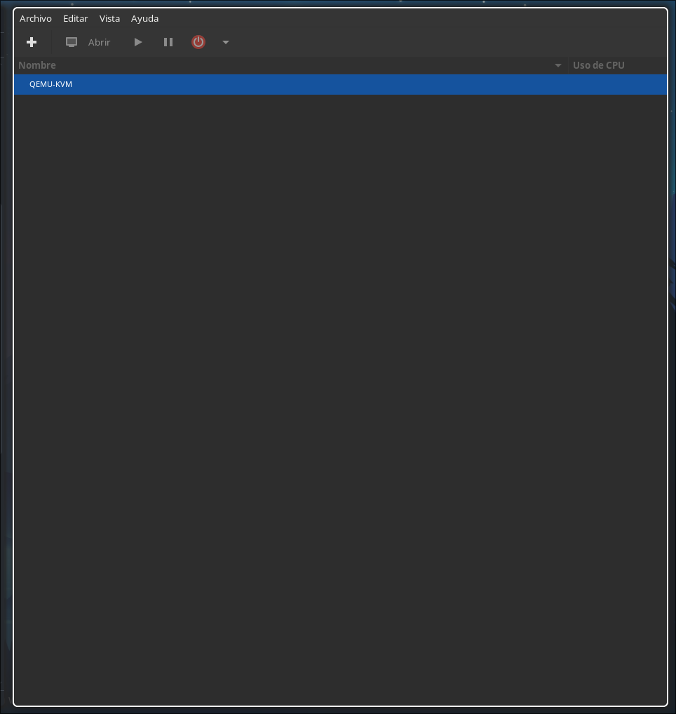
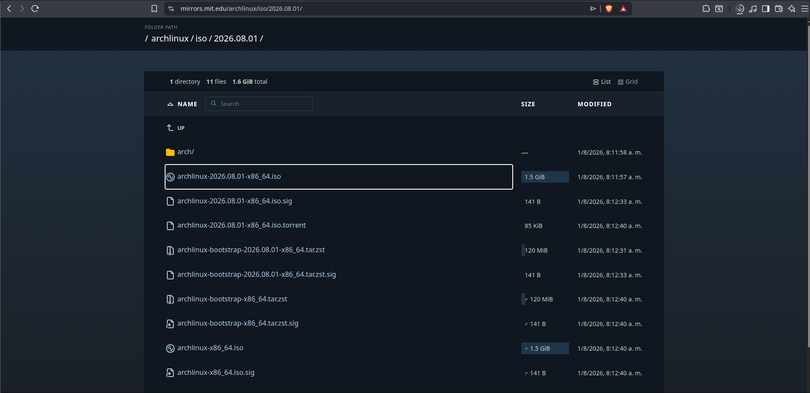
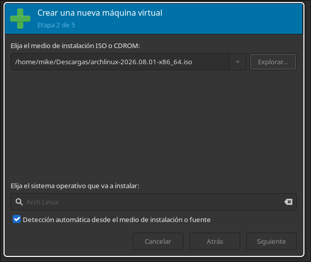
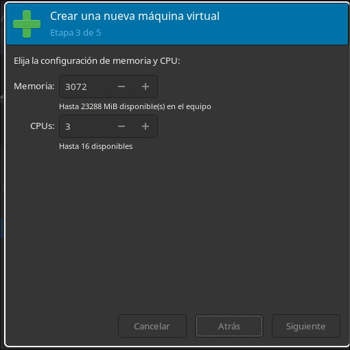
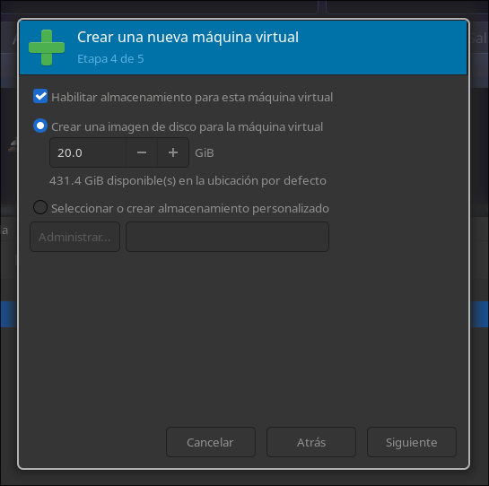
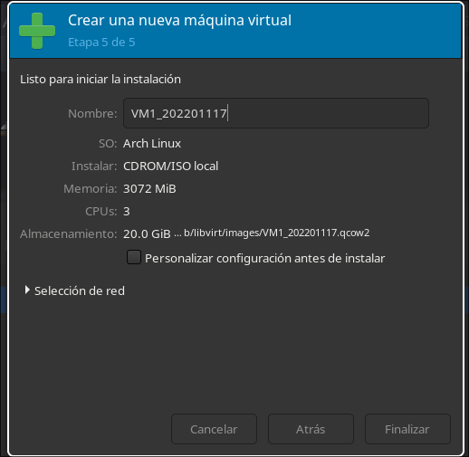
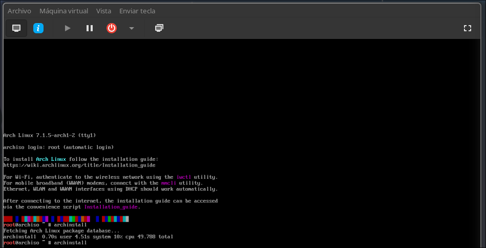
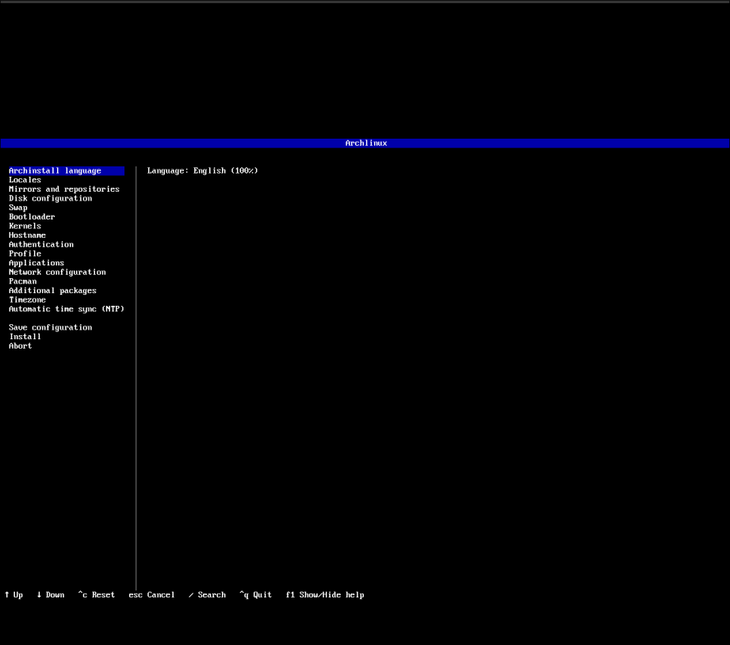
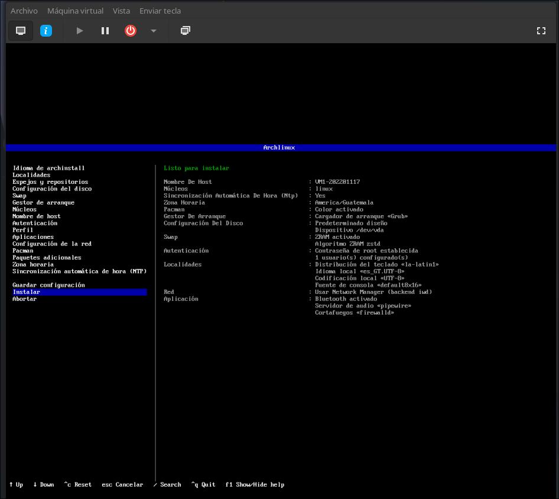
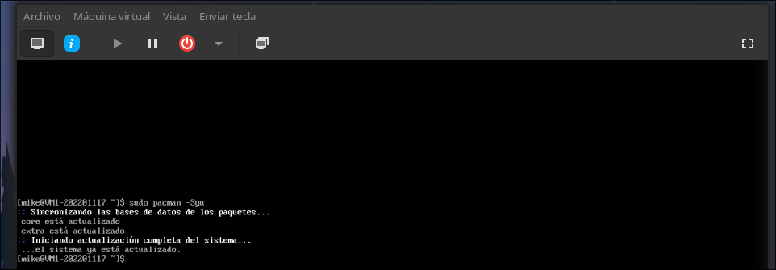

# GUIA DE INSTALACION
## INSTALACION DE QEMU - KVM - VIRTMANAGER
### 1. INSTALAR LOS PAQUETES NECESARIOS
``` bash
sudo pacman -Syu qemu-full virt-manager virt-viewer dnsmaq
```
#### Descripcion de cada paquete
- qemu-full: motor de virtualizacion 
- virt-manager: GUI para administras las VM
- virt-viewer: Visor para simular la pantalla de la VM
- dnsmaq: Sirve para DHCP y DNS ligero
### 2. HABILITAR EL SERVICIO Y AGREGAR EL USUARIO AL GRUPO
``` bash
sudo systemctl enable --now libvirtd.service

sudo usermod -aG libvirt $USER
```

### 3. CREAR LA MAQUINA VIRTUAL




#### Paso 1. Descargar la ISO
Descargamos la ISO desde la pagina oficial del distribuidor, en este caso estaremos usando arch linux por lo cual descargaremos desde la pagina de https://archlinux.org/download/


#### Paso 2. Seleccion de ISO

Una vez en virt manager le damos al boton de `+` para crear una nueva VM, una vez abierta esa opcion buscamos nuestro archivo `.iso` y lo seleccionamos



#### Paso 3. Asingacion de Memoria

Asignamos que cantidad de memoria virtual le queremos asginar a la VM, como solo sera por medio de CLI se le asginara 3GB de RAM y 3 nucleos de procesador



#### Paso 4. Almacenamiento

Asignamos 20GB a cada maquina para su almacenamiento permanente



#### Paso 5. Fin de la configuracion

Verificamos que todos los parametros de la VM esten correctos y finalizamos la etapa de creacion de la VM



### 4. CONFIGURAR EL SISTEMA OPERATIVO

Utilizaremos archinstall como instalador para facilitiar la instalacion. 

#### Archinstall

Una vez dentro del boot de nuestra distro lo que haremos es escribir 
`archinstall` en la terminal



y esto nos mostrara el instalador para que realicemos la configuracion de nuestro sistema operativo


Elegimos idioma, distribucion de teclado, dejamos que el mismo instalador configure el particionamiento del disco, añadimos contraseña del root y usuario. Para luego configurar zona horaria e instalamos



Al finalizar la instalacion seleccionamos que deseamos reiniciar e iniciamos sesion con nuestro usuario y actualizaremos el sistema usando
```bash
sudo pacman -Syu
```


y repetimos el mismo proceso para las otras 2 maquinas virtuales
